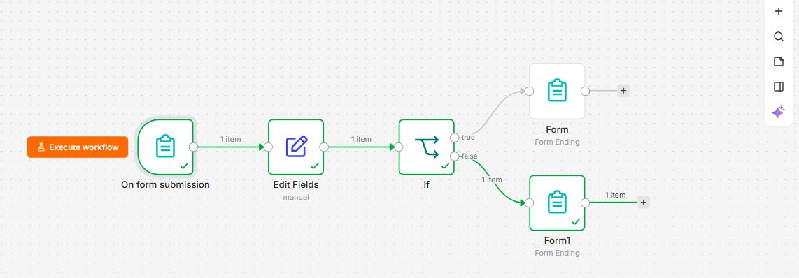

# n8n Customer Name Validation

**An automated customer registration and name-validation workflow built with n8n Cloud.**


---

## Project Overview

This project demonstrates how to build an automated customer name-validation system using **n8n**, a workflow automation platform.

The system receives a customer's name through an online registration form, cleans the submitted text, checks whether the resulting name is empty, and displays an appropriate response.

The project was developed as a practical exercise in workflow automation, data transformation, JavaScript expressions, conditional logic and form responses.

## Table of Contents

- [Project Objectives](#project-objectives)
- [Technology Stack](#technology-stack)
- [Workflow Architecture](#workflow-architecture)
  
- [How It Works](#how-it-works)
- [Validation Logic](#validation-logic)
- [Testing and Results](#testing-and-results)
- [Key Lessons Learned](#key-lessons-learned)
- [Project Limitations](#project-limitations)
- [Future Improvements](#future-improvements)

## Project Objectives

The workflow is designed to:

- Accept customer names through an online form.
- Remove unnecessary spaces from the beginning and end of submitted names.
- Reject empty submissions and submissions containing only spaces.
- Display an appropriate success or failure message.
- Demonstrate how n8n nodes exchange, transform and validate data.

## Technology Stack

| Technology | Purpose |
|---|---|
| n8n Cloud | Workflow automation platform |
| n8n Form Trigger | Collects customer input |
| Edit Fields | Cleans and transforms submitted data |
| IF Node | Evaluates the validation condition |
| Form Ending | Displays the appropriate response |
| JavaScript Expressions | Performs dynamic text processing |
| GitHub | Project documentation and version history |

## Workflow Architecture

```text
         CUSTOMER REGISTRATION FORM
                    |
                    v
           On Form Submission
                    |
                    v
               Edit Fields
          (Create CleanName)
                    |
                    v
                 IF Node
            (Is name empty?)
               /       \
              /         \
       NOT EMPTY        EMPTY
           |              |
           v              v
       SUCCESS          FAILURE
       Response         Response
```

The workflow contains five nodes and two possible outcomes.

## How It Works

### 1. On Form Submission

The workflow begins when a customer submits the registration form.

**Form title:** Customer Registration Form

**Input field:** Name

The Required Field setting is intentionally disabled to allow the workflow to demonstrate its own validation logic.

### 2. Edit Fields — Data Cleaning

The Edit Fields node creates a new field called `CleanName`.

**Expression:**

```javascript
{{ ($json.Name ?? '').trim() }}
```

This expression performs three operations:

1. Reads the submitted `Name` value.
2. Uses an empty string if the value is missing or null.
3. Removes spaces from the beginning and end.

For example:

| Original Input | CleanName |
|---|---|
| `"  Adewale  "` | `"Adewale"` |
| `"     "` | `""` |
| `""` | `""` |

### 3. IF Node — Validation

The IF node checks the cleaned name.

**Expression:**

```javascript
{{ $json.CleanName }}
```

**Condition:** String → Is Not Empty

If the condition is TRUE, the name contains text.

If the condition is FALSE, the name is empty after cleaning.

### 4. Successful Form Ending

When the condition is TRUE, the customer receives:

**Successful**

Your name has been submitted successfully.

### 5. Not Successful Form Ending

When the condition is FALSE, the customer receives:

**Not Successful**

Please enter your name before submitting the form.

## Validation Logic

The workflow separates data cleaning from decision-making.

The Edit Fields node prepares the input, while the IF node decides which response should be displayed.

This separation makes the automation easier to understand, test and maintain.

## Testing and Results

Three test scenarios were executed.

| Test | Customer Input | Expected Outcome | Result |
|---|---|---|---|
| 01 | Adewale | Successful | Passed |
| 02 | Empty name | Not Successful | Passed |
| 03 | Five spaces | Not Successful | Passed |

**Overall result: 3 of 3 tests passed (100% of the tested scenarios).**

The tests confirm that the workflow handles ordinary text, empty submissions and whitespace-only submissions as intended.

## Key Lessons Learned

Through this project, I gained practical experience with:

- Configuring an n8n Form Trigger.
- Understanding how data moves between workflow nodes.
- Cleaning input using JavaScript expressions.
- Using the nullish coalescing operator (`??`) and `.trim()`.
- Implementing conditional logic using an IF node.
- Returning different customer-facing form responses.
- Testing both successful and unsuccessful workflow paths.
- Documenting an automation project on GitHub.

## Project Limitations

This is a learning demonstration rather than a production-ready customer registration system.

The current validation checks whether the cleaned name contains any text. It does not verify whether the name contains valid letters, whether it belongs to a real person, or whether the same customer has registered previously.

A production implementation would require additional validation, privacy and security controls.

## Future Improvements

- Add stronger name-format validation.
- Save valid customer registrations to Google Sheets or a database.
- Add optional email notifications.
- Export the n8n workflow as a reusable JSON file.
- Add workflow screenshots and additional test evidence.
- Improve error handling and input validation.

## Project Status

**Demo V1 — Completed and tested**

All three documented test scenarios passed.

---

**Developed as part of a hands-on learning journey in n8n automation, JavaScript expressions and workflow engineering.**
